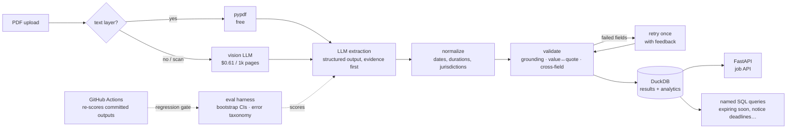

# docintel: contracts in, validated JSON out

A document-intelligence pipeline that reads commercial contracts (digital or scanned PDFs) and
extracts 14 fields (parties, dates, renewal terms, governing law, risk clauses) as **validated
JSON where every value carries its evidence quote, the quote's location in the document, and
a verification status**. Evaluated against lawyer-labelled ground truth, with confidence
intervals, and served through a job-based API.

**[results/contract-wise →](https://lavanyakonda-developer.github.io/doc-intelligence/)** Opens on the eval
results; in _contracts_, click any field to see the clause it came from, how the validator rated
it, and whether it matches the CUAD label.

Built on [CUAD](https://www.atticusprojectai.org/cuad) (The Atticus Project, CC BY 4.0):
510 commercial contracts with expert annotations.

## The problem

Contract review means finding a handful of facts buried in 10 to 60 pages: who signed, when it
expires, whether it auto-renews and how much notice you need to give, whether liability is
capped. An LLM can pull these out, but in practice the hard part is everything around the call:

- **Scanned PDFs** have no text layer.
- **Values must be checkable:** a date the model produced without evidence isn't worth much.
- **"Is it good?" needs a number** with an honest error bar, not a demo on cherry-picked files.
- **Cost:** a pipeline that is accurate but costs $0.50 per contract doesn't get used.

## Architecture



Each stage is cached on disk by content hash, so re-running the same document costs $0.

## Results

30-contract golden set (8 dev / 22 held-out test), stratified by length and contract type.
F1 counts every field (list fields item by item). 95% CIs come from 2,000 bootstrap resamples
of **documents**: fields within a contract are correlated, so the document is the unit.

| model                    | P    | R    | F1 [95% CI]           | $ / contract |
| ------------------------ | ---- | ---- | --------------------- | ------------ |
| **gpt-6-luna** (shipped) | 79.3 | 90.4 | **84.5** [73.6, 92.2] | **$0.002**   |
| gpt-6.1-terra            | 78.8 | 90.9 | 84.4 [73.5, 91.9]     | $0.019       |

**The 10× more expensive model buys nothing.** On the same resampled documents (paired
bootstrap), terra − luna = −0.1 F1 [−3.7, +3.5], within the ±3-point noise between two runs
of the _same_ model.

| field type                     | F1 [95% CI]                         | notes                                              |
| ------------------------------ | ----------------------------------- | -------------------------------------------------- |
| governing law (enum)           | 100.0                               | normalized to country / state                      |
| durations (renewal, notice)    | 93.3 [75.0, 100]                    | `30 business days` ≠ `30 days`, on purpose         |
| document name                  | 90.9 [77.3, 100]                    |                                                    |
| dates                          | 89.8 [78.1, 97.2]                   | relative expirations computed by code, not the LLM |
| boolean risk clauses           | 82.5 [72.5, 90.9]                   |                                                    |
| cap on liability (clause text) | 75.9 [53.3, 94.1]                   |                                                    |
| parties (list)                 | 74.2 item-level · 90.8 per-contract | one contract lists 26 trusts as parties            |

### Parsing scanned contracts: cost vs quality

Same 6 contracts (57 pages) as digital PDFs and as synthetic scans. _Evidence recall_ = share
of the lawyer-highlighted clauses still findable in the parsed text.

| parser                      | clean | light scan | heavy scan | $ / 1k pages       |
| --------------------------- | ----- | ---------- | ---------- | ------------------ |
| pypdf (text layer)          | 100%  | 0%         | 0%         | $0                 |
| Docling + RapidOCR (local)  | 97.2% | 93.0%      | 84.5%      | $0 (≈3 s/page CPU) |
| **vision LLM (gpt-6-luna)** | 100%  | 100%       | **100%**   | **$0.61**          |

End-to-end extraction F1 on the heavy scans: vision 85.5 vs 86.0 on the clean digital PDFs
(Δ −0.5 [−3.1, +1.9]); Docling 78.0 (Δ −8.0 [−13.4, −2.4]). **Routing:** pypdf when a text
layer exists, otherwise vision.

Full tables, including breakdowns by document length, validator status and match-threshold
sensitivity, are in [`docs/RESULTS.md`](docs/RESULTS.md).

## What worked, what didn't, and why

**Worked**

- **Evidence before value** in the output schema: the model quotes first, then answers. Every
  quote is located in the document (exact, then fuzzy), which gives the UI character offsets
  for highlighting.
- **Let code do the arithmetic.** The model reports "5 years from the Effective Date"; code
  computes the date. Derived dates scored 100% on the test set.
- **Measuring noise before comparing.** Three replicates of the same configuration differ by up
  to ~2.3 F1, which is larger than the gap between prompt v2 and v3, and between the two models.
  Paired bootstrap turned "looks better" into "isn't distinguishable".
- **Auditing the ground truth independently of the model.** A script checks every CUAD label
  against its own highlighted span. Only labels contradicted by their own evidence are
  corrected (5 of ~400, listed with reasons), so the eval isn't bent toward the model.

**Didn't work (or less than hoped)**

- **Retry with validator feedback** fixed 1 of 4 failures. The deterministic checks catch
  fabricated or malformed values, but the model almost never fabricates: its errors are
  _grounded but wrong_ (a real clause, misread or not the right one), which no grounding check
  can see.
- **Abstention** (hold back unverified values): precision 79.3 → 82.2 at 88% coverage, with no
  F1 gain. Agreement across three runs is a stronger signal (89.9% vs 43.8% accuracy), at 3× cost.
- **Docling on scans**: fine on light scans, but lost 15% of clauses on heavy ones, and Apple
  GPU acceleration crashed on macOS 14 (CPU only).
- **Label noise caps the score.** Reviewing test errors turned up near-identical
  change-of-control clauses labelled _True_ in one contract and _False_ in another, and
  textbook termination-for-convenience clauses ("either party on 60 days' notice") left
  unlabelled. The official metric still uses the labels as they are; the error taxonomy
  reports how much of the error is label noise.

## Run locally

```bash
make setup                 # uv sync + pre-commit hooks (Python 3.12, uv)
cp .env.example .env       # add OPENAI_API_KEY (only needed to process new PDFs)
make serve                 # API at http://127.0.0.1:8000, docs at /docs
```

The API seeds itself with the 30 precomputed golden-set contracts, so queries and results work
without downloading CUAD or an API key:

```bash
curl -F "file=@contract.pdf" localhost:8000/v1/jobs           # 202 {job_id, status_url}
curl localhost:8000/v1/jobs/<job_id>                          # queued | running | done (+ result)
curl "localhost:8000/v1/queries/renewal_notice_deadlines"     # last day to send non-renewal
uv run docintel extract contract.pdf                          # same pipeline, from the CLI
make web                                                      # the demo UI (Node 22+)
```

Extraction takes ~5 s for a digital contract and ~40 s for a scan, so the API is job-based:
`POST` returns 202 and the client polls. The same file uploaded again returns the stored
result instantly (keyed by content hash).

To reproduce the experiments: `make data` (download CUAD), then `make parsers`, `make extract`
and `make eval`. Every run is cached; the whole project cost **$0.93** in API calls
([`docs/COSTS.md`](docs/COSTS.md)).

## Analytics on extracted contracts

Records are stored as typed columns (dates, durations in days, booleans), so portfolio questions
become SQL ([`storage/store.py`](src/docintel/storage/store.py)):

| query                          | question it answers                                                          |
| ------------------------------ | ---------------------------------------------------------------------------- |
| `expiring_soon as_of=… days=…` | Which contracts expire in the next N days?                                   |
| `renewal_notice_deadlines`     | Auto-renewing contracts: last day to send a non-renewal notice               |
| `uncapped_liability`           | Where is liability uncapped, with the clause quoted                          |
| `governing_law_mix`            | Which jurisdictions govern the portfolio                                     |
| `needs_review`                 | Fields that failed or couldn't be verified, with reasons                     |
| `risk_flags`                   | Contracts ranked by exclusivity / non-compete / uncapped / change of control |

## Observability

Every document produces one trace in a local [Arize Phoenix](https://github.com/Arize-ai/phoenix)
(no account, no cloud): `process_pdf → parse → extract → [LLM call] → validate → retry`, with
model, prompt version, parser, tokens, cost and validator reasons as span attributes. The OpenAI
call is auto-instrumented (OpenInference); pipeline stages are custom OpenTelemetry spans, and
the code only depends on the OTel API, so with tracing off (tests, CI) it costs nothing.

**Traces are linked to eval results.** After a traced run, the eval harness attaches the outcome
of every field (correct / partial / wrong vs the CUAD label) and a per-document F1 to that
document's trace, so a question like _"show me every contract where governing law was wrong"_
is a filter in Phoenix, and one click opens the exact prompt, response and validator verdict.

```bash
make phoenix   # UI on http://localhost:6006
make traces    # traced golden-set run (~$0.06) + eval annotations (449 on 30 traces)
```

<!-- SCREENSHOTS: trace tree · annotation filter (governing_law == wrong) · span attributes -->

## Engineering

- **CI** (GitHub Actions, no secrets, no API calls): lint, 160+ tests, and an **eval regression
  gate** that re-scores committed model outputs with the current code. A change to a normalizer
  or matcher that moves F1 fails the build. Verified with an injected bug: ΔF1 −19.8, exit 1.
- **Why there's no live API:** hosting would be free, but every upload is a paid LLM call, and
  an open endpoint is a cost and abuse risk. The public demo serves precomputed output of the
  real pipeline instead.
- **Layout:** `src/docintel/` with `parsing/`, `extraction/`, `validation/`, `eval/`, `storage/`
  and `api/`, plus `pipeline.py` (the single entry point), `scripts/` (experiments, reports),
  `evalsets/` (golden set, ground truth, overrides, CI snapshot), `prompts/` (versioned by
  hash) and `web/` (demo UI).
